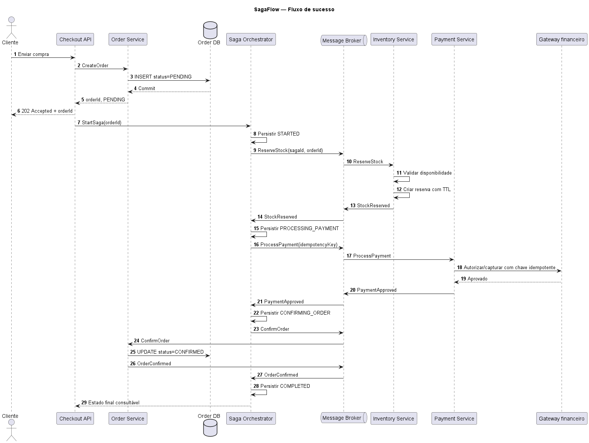
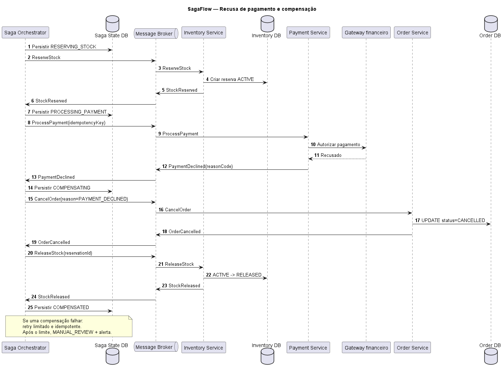

# SagaFlow: Modelagem do Padrão Saga em Microsserviços

## 1. Visão geral

O **SagaFlow** é uma proposta de arquitetura que demonstra como aplicar o padrão **Saga** em um fluxo de compra distribuído, envolvendo criação de pedido, reserva de estoque e processamento de pagamento.

Em uma arquitetura de microsserviços, cada serviço gerencia suas próprias transações locais. Como não existe uma única transação ACID abrangendo todos os serviços, uma falha pode exigir ações compensatórias para manter a consistência do processo de negócio.

Este projeto apresenta uma modelagem arquitetural e seus fluxos. Os diagramas e mecanismos descritos representam uma proposta de solução, não uma implementação funcional dos serviços.

## 2. Objetivos

- Modelar uma Saga com orquestração centralizada.
- Representar o fluxo de sucesso de uma compra.
- Demonstrar a compensação após a recusa de pagamento.
- Documentar idempotência, timeouts, retentativas e recuperação de falhas.
- Registrar decisões arquiteturais, riscos e estratégias de mitigação.

## 3. Arquitetura proposta

A solução utiliza o padrão **Saga Orchestration**. Um orquestrador persistente coordena as etapas do processo, envia comandos aos serviços e recebe eventos com os resultados.

Principais componentes:

- **API / Checkout:** recebe a solicitação de compra e inicia o processo.
- **Order Service:** cria, confirma ou cancela pedidos.
- **Inventory Service:** reserva e libera estoque.
- **Payment Service:** solicita a autorização ou captura do pagamento.
- **Gateway financeiro:** representa o sistema externo de pagamentos.
- **Message Broker:** transporta comandos e eventos entre os componentes.
- **Saga Orchestrator:** controla as etapas, registra o estado da Saga e coordena compensações.
- **Bancos de dados:** armazenam os dados de cada serviço e o estado da Saga.

## 4. Fluxo de sucesso

1. O cliente envia uma solicitação de compra.
2. O sistema cria o pedido com estado `PENDING`.
3. O orquestrador inicia a Saga e solicita a reserva do estoque.
4. O serviço de estoque confirma a reserva.
5. O orquestrador solicita o processamento do pagamento.
6. O pagamento é aprovado.
7. O orquestrador solicita a confirmação do pedido.
8. O pedido passa para `CONFIRMED` e a Saga termina em `COMPLETED`.

### Diagrama de sequência: sucesso



Arquivo-fonte editável: [`sequence-success-flow.puml`](diagrams/sequence-success-flow.puml).

## 5. Fluxo de falha e compensação

Se o pagamento for recusado após a reserva do estoque, o orquestrador inicia a compensação:

1. Registra o estado `COMPENSATING`.
2. Solicita o cancelamento do pedido.
3. Aguarda a confirmação do cancelamento.
4. Solicita a liberação do estoque reservado.
5. Aguarda a confirmação da liberação.
6. Registra o estado `COMPENSATED`.

Se uma compensação falhar, a proposta prevê retentativas limitadas, operações idempotentes, alerta e encaminhamento para revisão manual quando necessário.

### Diagrama de sequência: compensação



Arquivo-fonte editável: [`sequence-compensation-flow.puml`](diagrams/sequence-compensation-flow.puml).

## 6. Visão geral da arquitetura

O diagrama a seguir apresenta os principais componentes, suas bases de dados e a comunicação por comandos e eventos.


Arquivo-fonte editável: [`saga-architecture-overview.puml`](diagrams/saga-architecture-overview.puml).

## 7. Confiabilidade e tratamento de falhas

A proposta considera os seguintes mecanismos:

- **Idempotência:** impedir que mensagens repetidas provoquem a execução duplicada de uma operação.
- **Persistência do estado da Saga:** permitir acompanhamento e recuperação após falhas.
- **Timeouts:** limitar o tempo de espera por respostas.
- **Retentativas limitadas:** repetir operações transitórias de acordo com uma política definida.
- **Transactional Outbox:** reduzir o risco de inconsistência entre a gravação no banco e a publicação de eventos.
- **Dead Letter Queue (DLQ):** armazenar mensagens que não puderam ser processadas após as tentativas configuradas.
- **Circuit Breaker:** evitar chamadas repetidas a uma dependência que esteja falhando.
- **Observabilidade:** registrar estados, erros e identificadores de correlação para facilitar o diagnóstico.

Esses mecanismos são decisões de projeto documentadas, não funcionalidades implementadas neste repositório.

## 8. Estrutura do repositório

```text
sagaflow/
├── README.md
├── diagrams/
│   ├── saga-architecture-overview.png
│   ├── saga-architecture-overview.puml
│   ├── sequence-success-flow.png
│   ├── sequence-success-flow.puml
│   ├── sequence-compensation-flow.png
│   └── sequence-compensation-flow.puml
└── docs/
    └── decisoes-arquiteturais.md
```

Os arquivos `.png` permitem visualizar os diagramas diretamente no GitHub. Os arquivos `.puml` contêm os respectivos códigos-fonte PlantUML.

## 9. Decisões arquiteturais

As principais decisões, os riscos identificados e as estratégias de mitigação estão documentados em [`docs/decisoes-arquiteturais.md`](docs/decisoes-arquiteturais.md).

## 10. Referências

- Microsoft. [Saga design pattern](https://learn.microsoft.com/en-us/azure/architecture/microservices/design/patterns).
- Richardson, C. Microservices.io. [Saga pattern](https://microservices.io/patterns/data/saga.html).
- Richardson, C. Microservices.io. [Transactional Outbox pattern](https://microservices.io/patterns/data/transactional-outbox.html).

---

**Status do projeto:** modelagem e documentação arquitetural. Os serviços, o broker e as integrações descritos são componentes conceituais da proposta.
